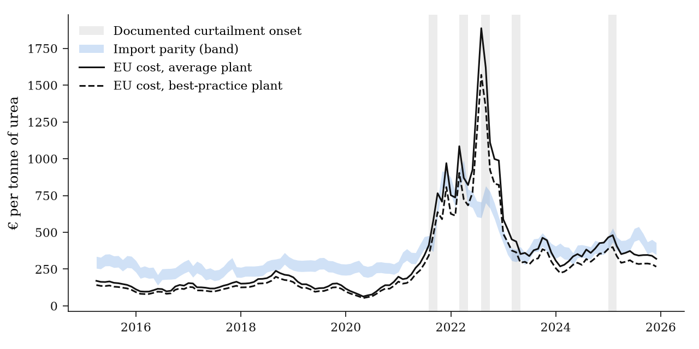
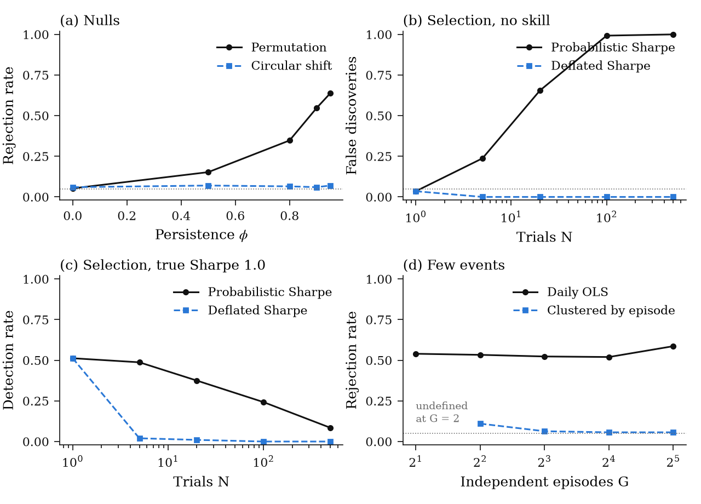

# N-Squeeze

**Inferring commodity fundamentals from physical data, with Europe's gas-to-nitrogen chain as a case study**

Andriy Kovalchuk · work in progress · October 2026

## Summary

I build a cost model of European nitrogen production and test it against independent data. A model works to predict a quantity. A separate measurement observes it. I treat the difference as a signal after it passes the following tests in a fixed order: measurement, information, price impact and tradability. Every input has an evidence grade. I store every data series point-in-time.

On official monthly data for April 2015 to December 2025, a margin bound with no fitted parameters is never negative before 2021. It turns negative within one month of the documented curtailment onsets of August 2021 and March 2022. I keep the 2026 tests sealed until I commit the pre-registration.

<p align="center">
  
</p>

<sub><b>Figure.</b> EU cash cost of a tonne of urea from gas and carbon only, against landed import parity. Carbon is at the full allowance price. The figure excludes other cash costs. The band spans freight of $15–80 per tonne and duties of 0–6.5%. Grey bands mark documented curtailment onsets. I seal data after December 2025. Sources: World Bank, EEX, ECB, my calculations.</sub>

## The question

Europe imports nitrogen, so its producers sell at **import parity**: the cost of landing a tonne from the cheapest foreign origin. In 2021–22 the gas shock was European. Gas rose, parity did not, so plants lost margin between cost and an import-capped price. In 2026 the closure of the Strait of Hormuz removed Qatari LNG and much of the world's traded urea and ammonia at the same time. So parity may rise with cost. Whether European producers lose margin or stay protected this time is, for me, an empirical question.

## Method

A structural model predicts a quantity, $\hat Q_t = f(X_t, \theta)$, for example the share of EU ammonia capacity that should be running. An independent measurement observes it as $\tilde Q_t$. The surprise $S_t = \tilde Q_t - \hat Q_t$ is the part a market that already sees $X_t$ cannot compute. It becomes a signal only if it passes, in order:

| Test | Data | Result from the simulations |
|---|---|---|
| 1 Measurement | Signal-to-noise ratio on changes | Fix the threshold before estimation. Levels look better than they are |
| 2 Information | Information coefficient (HAC), Diebold–Mariano against baselines | Placebos by circular shift, not permutation |
| 3 Price impact | Event study, clustered by event | No regime-level p-values with two regimes |
| 4 Tradability | Total returns, costs, deflated Sharpe ratio | One primary specification per hypothesis. I log every trial |

## Results so far

| | Result |
|---|---|
| Gas cost of a tonne of NH₃, Sep 2021 | $856 for the EU average plant, against $900 quoted by CF's CEO |
| Margin bound, Apr 2015 – Dec 2020 | Negative in 0 of 69 months, for every plant tier and parity edge |
| Onset Aug 2021 | Bound turns negative within 1 month, in 4 of 4 specifications |
| Onset Mar 2022 | Bound turns negative within 1 month, in 3 of 4 specifications |
| Onset Aug 2022 | Bound already negative in 3 of 4 specifications, turns negative on time in the fourth |
| Onsets Mar 2023, Jan 2025 | Bound already negative in 3 and 2 of 4 specifications. Consistent, but not a test of timing |
| Fitted threshold, leave one episode out | Hits Aug 2021 and Mar 2022. The other three episodes fall inside spells that had already started |

The episode record has 11 documented curtailment onsets in 5 episodes, each with a source, in [`config/episodes.csv`](config/episodes.csv).

<p align="center">
  
</p>

<sub><b>Figure.</b> Simulation study. (a) Permutation nulls over-reject as persistence rises. Circular shifts do not. (b) The best of N strategies with no skill looks significant. The deflated Sharpe ratio removes this bias. (c) The cost of that correction: power falls after a few trials. (d) Daily OLS over-rejects with few independent episodes. Clustered inference works from about eight episodes and does not exist at two.</sub>


## Reproduce

```bash
python -m venv .venv
.venv/Scripts/activate
pip install -e ".[dev]"
pytest
```

Data go into a local store (`data/`):

```bash
nsq sources
nsq archive pink_sheet_monthly --since 2015-01-01
nsq jobs new agsi-2015 --source agsi --since 2015-01-01
nsq jobs run agsi-2015
# nsq jobs --help
```

Copy `.env.example` to `.env` and fill it in.

## Repository

```text
nsqueeze/    model code: units, parameters, cost stack, import parity, gas balance,
             validation tests, simulation, data fetchers (io/), job runner
config/      graded parameters, dated policy rules, episodes, data sources, freeze state
archivers/   Windows scheduled tasks and the live AIS stream
tests/       unit tests
```

## Status

| Phase | Scope | Status |
|---|---|---|
| 0 | Point-in-time store and archivers | 13 sources live. Daily schedule ready |
| 1 | Nitrogen cost stack | First results above. Plant list and CBAM values open |
| 2 | EU gas balance and end-of-winter forecast | Model and calibration test coded. Fit waits for storage history |
| 3 | Satellite plant activity | Not started |
| 4–5 | Shipping data, strategies, write-up | Not started |

## Citation

```bibtex
@techreport{kovalchuk2026nsqueeze,
  author = {Kovalchuk, Andriy},
  title  = {Inferring Commodity Fundamentals from Physical Data: A Pre-registered Framework,
            with Europe's Gas-to-Nitrogen Chain as a Case Study},
  type   = {Working paper},
  year   = {2026}
}
```

<sub>Code under the MIT licence. Data remain under their providers' terms (World Bank CC BY 4.0, EEX, ECB, Eurostat, GIE, ENTSOG, IMF PortWatch, Open-Meteo).</sub>
